# Plant-Based Living Lab — 自主學習完整研究計畫書

> **從素食家庭到永續生活的跨領域問題解決計畫**
>
> 版本：1.0（規劃稿）｜更新：2026-11-12｜語言：繁體中文｜對應網站：[Plant-Based Living Lab](../index.html)
>
> **文件定位：** 提供學生理解與執行、老師審查研究設計、未來整理申請入學資料，以及匯入 NotebookLM 製作口語導讀的共同原始文件。
>
> **重要狀態：** 本文件記錄已討論的 **16 個候選題目**，不是正式選定的六個研究專題，也不是已完成的實驗。所有結果欄位均待填；示意圖和欄位不代表真實成果。

---

## 目錄

1. [使用說明與讀者指南](#1-使用說明與讀者指南)
2. [從生活問題開始的 Brainstorming](#2-從生活問題開始的-brainstorming)
3. [完整心智圖與問題地圖](#3-完整心智圖與問題地圖)
4. [網站地圖、內容結構與產出架構](#4-網站地圖內容結構與產出架構)
5. [三學期規劃與選題原則](#5-三學期規劃與選題原則)
6. [研究方法與驗證標準](#6-研究方法與驗證標準)
7. [16 題完整研究設計](#7-16-題完整研究設計)
8. [陽台農園四題的共同實驗與設計](#8-陽台農園四題的共同實驗與設計)
9. [教師檢查與階段驗收](#9-教師檢查與階段驗收)
10. [通用資料表與結案報告模板](#10-通用資料表與結案報告模板)
11. [預期結案圖表與 Mermaid 填值模板](#11-預期結案圖表與-mermaid-填值模板)
12. [學習歷程、作品集與入學面試](#12-學習歷程作品集與入學面試)
13. [NotebookLM 廣播轉換用文字](#13-notebooklm-廣播轉換用文字)
14. [研究倫理、風險與資料管理](#14-研究倫理風險與資料管理)
15. [可查證的參考資源與待補事項](#15-可查證的參考資源與待補事項)
16. [結案封存與下一版決策](#16-結案封存與下一版決策)

## 1. 使用說明與讀者指南

### 1.1 這份文件要解決什麼問題？

高中自主學習不能只是一個漂亮的題目名稱。它需要回答：問題從哪裡來、為什麼值得做、怎樣知道真的改善了、使用什麼證據、最後學到了什麼。本計畫從家庭素食經驗出發，擴展到健康、食品成分、學校服務、價格、材料、環境、文化、AI，以及家庭陽台種植與智慧農園。

本文件是 **研究總藍圖和可修改的工作底稿**。學生不需要同時完成16題；也不應為了好看而做16個表面作品。較好的做法是從候選題裡逐步收斂，保留完整的研究與放棄理由，最後形成可證明個人成長的系列成果。

### 1.2 四種讀者如何使用？

| 讀者 | 優先閱讀 | 讀完要能回答 |
|---|---|---|
| 學生 | 第2、3、5、7、8、10章 | 我想研究哪個問題？這週要做什麼？要記錄哪些數據？ |
| 指導老師 | 第5、6、7、9、14章 | 問題是否足夠聚焦？能否安全實施？評量依據是否明確？ |
| 未來入學審查與面試 | 第6、10、12、16章 | 學生做了哪些決策？怎麼處理反例與失敗？證據能否追溯？ |
| NotebookLM／語音導讀 | 第1、2、3、5、8、13章 | 能否不看圖，就聽懂研究起源、選題邏輯、方法與成果？ |

### 1.3 訊息的真實性標籤

- **[討論確定]**：本計畫已提出的方向，例如三學期、16個候選題目及六題正式研究的構想。
- **[建議方案]**：本報告提供的執行方法；可由學生與指導老師調整，不代表使用者已同意選用。
- **[研究假設]**：尚未驗證、可能被反駁的預測。
- **[需外部查證]**：來源、法規、設備、成本、學校資源、植物種植條件等尚需在實施時確認。
- **[待測／待填]**：尚無結果，不得為了圖表完整而假造數據。

### 1.4 明確不做的事

- 不替學生決定最後的六題，也不宣稱13–16已經加入某學期。
- 不預設家庭陽台已同意作實驗場；詳細尺寸、方向、日照與用電配置要實測確認。
- 不把外部網站的產品主張當作自己的實驗結果。
- 不聲稱學生已完成訪談、問卷、App、成本效益、實驗或入學成果。
- 不把大學招生規範、學校課程時數或評分表當成已取得的官方規定；本文件的評分表僅是建議工具。

---

## 2. 從生活問題開始的 Brainstorming

### 2.1 核心起點

原始核心不是「要做一個AI App」或「要種菜」，而是 **素食家庭在日常生活中有哪些尚未解決的問題？**

由此產生一連串追問：

1. 吃素能不能吃得營養、便利又有合理預算？
2. 食品包裝上的成分是否容易辨識？模糊成分該怎麼辦？
3. 校園供餐是否照顧不同飲食需求？
4. 素食的價格和準備時間，是否真的比較省？
5. 如果不使用動物性材料，能不能做出有實用價值的替代品？
6. 家庭蔬菜浪費的成本和環境負擔是多少？
7. 素食是否一定更永續？系統邊界如何影響結論？
8. 不同文化如何理解素食，是否存在誤解或刻板印象？
9. 能否用地圖、資料庫或AI讓生活決策更容易？
10. 如果在家庭陽台自己種蔬果，會遇到哪些日照、供水、成本與維護問題？

### 2.2 從「有趣」到「可研究」

**發散階段**允許想像和矛盾。例如：「LED種菜是否可能比買菜更貴，卻更能控制品質？」、「毛細供水是否降低工時，但使初期硬體投資增加？」、「AI幫忙選菜是否可能比試算表更容易犯錯？」

**收斂階段**必須把模糊問題變成：研究對象、可取得的資料、可控變因、量測指標、時間預算、風險與可反駁假設。失敗的假設也可能產生高品質的學習歷程。

### 2.3 起源與後續擴展的關係

| 探索階段 | 當時的提問焦點 | 形成的候選群 |
|---|---|---|
| A 生活問題 | 家庭營養、食材標示、校園選擇、價格 | 01–04 |
| B 實驗與永續 | 材料、乳液、保存、碳排 | 05–08 |
| C 文化與社會應用 | 全球文化、生活地圖、創業、AI整合 | 09–12 |
| D 陽台農園擴展 | DIYGreen、光照與LED、節水、感測與成本 | 13–16 |

這四段是 **討論脈絡的整理**，不是已正式核准的四學期課程。

---

## 3. 完整心智圖與問題地圖

### 3.1 主心智圖：從素食家庭放射成16題

本圖採用 GitHub 相容性較高的 Mermaid flowchart 表示心智圖。分類只是閱讀輔助；一個題目可以同時屬於多個學科。

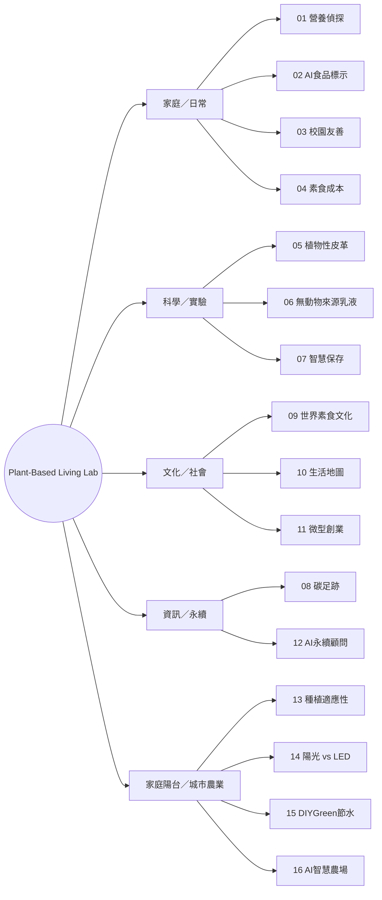

### 3.2 領域交叉：不要把學科當成孤島

| 生活問題 | 生物與化學 | 數學與經濟 | 人文與社會 | 資訊與工程 |
|---|---|---|---|---|
| 家庭飲食 | 營養素、食品成分 | 成本與菜單優化 | 飲食偏好 | 營養資料表 |
| 校園友善 | 食品安全基礎 | 問卷統計與成本 | 公民、服務設計 | 標示與地圖 |
| 植物材料 | 材料與乳化 | 製程單位成本 | 永續宣稱與倫理 | 實驗資料可視化 |
| 碳排與浪費 | 保存、環境機制 | LCA、敏感度 | 行為改變 | 計算器 |
| 陽台農園 | 光合作用、根系 | 水電與產量 | 家庭採用意願 | 感測器與儀表板 |

### 3.3 用問題樹檢查一個提問是否成熟

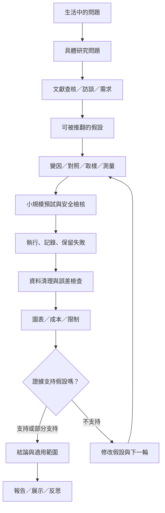

**口語說明：** 一個研究不是從「我要證明某技術有效」開始，而是從生活中的困難開始。先找到可信資料，再寫出可能被實驗推翻的假設，設計對照與量測。結果出來後先查核錯誤，再決定是否支持原本想法；如果不支持，應記錄為發現。

---

## 4. 網站地圖、內容結構與產出架構

### 4.1 網站地圖

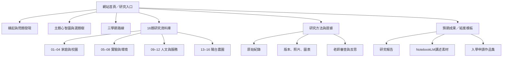

### 4.2 GitHub 專案與研究資料的建議存放方式

以下是 **未來資料夾建議**，不是宣稱這些檔案已經存在。

~~~text
plant-based-living-lab/
├─ index.html                 # 已有：網站首頁
├─ assets/                    # 已有：SVG主題插畫
├─ README.md                  # 已有：專案入口
└─ docs/
   ├─ MASTER_PLAN.md          # 本文件：整體規劃與結案模板
   ├─ research/               # 建議：參考文獻、來源查核、調查原稿
   ├─ proposals/              # 建議：選定題目後的正式提案
   ├─ protocols/              # 建議：標準實驗流程和變更紀錄
   ├─ data/                   # 建議：去識別化資料與資料字典
   ├─ reports/                # 建議：正式結案報告
   ├─ figures/                # 建議：數據產生的圖表
   └─ portfolio/              # 建議：未來學習歷程和面試摘要
~~~

如涉及學生個資、家庭敏感資訊、未公開問卷原始資料或第三方圖片，**不得直接存入 Public Repository**；應採匿名化、授權或僅放示例資料。

### 4.3 三層成果

1. **研究層：** 問題、設計、原始紀錄、程式與可重現的計算。
2. **溝通層：** 網站、圖表、Mermaid流程、短片、公開展示與NotebookLM語音。
3. **升學層：** 研究動機、學生自主決策證據、困難與修正、成果與反思。

---

## 5. 三學期規劃與選題原則

### 5.1 原始架構：每學期四個候選，正式選兩題

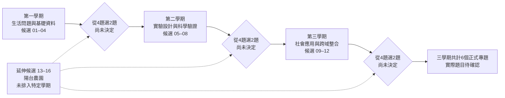

**必須保留的限制：** 01–04、05–08、09–12是當前規劃的三組候選；13–16是後續新增的陽台農園方向，**尚未確定是否替換前面候選**。因此任何六題組合都只是候選，不得在本計畫內當作最終決策。

### 5.2 選題矩陣：由學生與老師實際評分，尚未填分數

每項給 1–5 分，權重可調整；下表是建議尺規，而不是最後選題結果。

| 評估面向 | 建議權重 | 1分 | 5分 | 題目編號／得分 |
|---|---:|---|---|---|
| 學生真實興趣與主導性 | 20% | 無持續動機 | 能主動提出研究問題 | 待填 |
| 問題的可量測性 | 20% | 無法定義結果 | 可設對照與量化 | 待填 |
| 時間、預算與場地可行性 | 20% | 主要資源缺乏 | 現有資源足夠 | 待填 |
| 跨學科學習深度 | 15% | 僅表面介紹 | 能說明專業原理與限制 | 待填 |
| 公共價值或真實使用者 | 10% | 缺明確使用情境 | 可得到真實回饋 | 待填 |
| 可追溯證據與作品 | 15% | 只能口述 | 有原始資料和版本記錄 | 待填 |

**判定順序：** 先過安全與倫理門檻，再看興趣、研究能力與資源；不是單純追求最高分或最炫技術。

### 5.3 每學期18週的「相對週次範本」

下列週次只是 **規劃模板**，不是學校已公告的課表。若實際自主學習為16週或其他安排，需按學校時數重新調整。

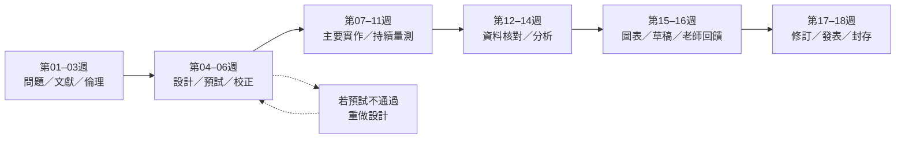

| 週次 | 主要工作 | 必留證據 | 老師檢查點 |
|---|---|---|---|
| W01–W03 | 研究問題、背景資料、資源盤點、倫理與安全 | 問題樹、來源清單、研究動機 | 問題是否可研究？ |
| W04–W06 | 假設、對照、變因、取樣、預試 | 研究計畫v1、設備表、預試數據 | 量測可重複嗎？ |
| W07–W11 | 主要實作、日誌、資料備份 | 紀錄檔、照片、版本註記 | 資料有遺漏嗎？ |
| W12–W14 | 資料清理、統計、反例、成本 | 資料字典、分析表、圖表初稿 | 結論有被數據支持嗎？ |
| W15–W16 | 報告撰寫與公開表達 | 報告草稿、簡報、影片稿 | 限制是否誠實呈現？ |
| W17–W18 | 修訂、發表與封存 | 結案報告、反思、材料存檔 | 是否完成學習目標？ |

### 5.4 同時做兩題如何避免過載？

- 一題可偏實驗、另一題偏資料或社會研究，但是否搭配由學生決定。
- 共用資料要事先定義來源與倫理，不要讓同一份資料被重複誇大為兩次獨立驗證。
- 任何一題無法取得材料、足夠時間或有效受訪者時，允許降階成可解釋的預試研究。

---

## 6. 研究方法與驗證標準

### 6.1 寫出可反駁的假設

不佳：「LED植物燈比太陽好。」因為沒有定義什麼是好。

較佳：「在相同品種、栽培期間與可取得的水肥條件下，LED組和自然光組的可食鮮重、鮮重含水率、總耗電與每100g生產成本有差異。」**方向和數值必須由實驗決定。**

### 6.2 變因與對照的最小要求

| 欄位 | 必填內容 | 簡例 |
|---|---|---|
| 研究問題 | 可測且聚焦 | A／B供水系統有何差異？ |
| 自變因 | 主動改變的條件 | 傳統盆／毛細儲水 |
| 依變因 | 主要比較結果 | 累計補水L、收成鮮重g |
| 控制變因 | 盡量維持一致 | 品種、盆容量、介質、日期 |
| 干擾因子 | 可能無法控制 | 雨量、風、病蟲害 |
| 取樣與重複 | 樣本數及配置依據 | A、B各至少3盆為探索起點 |
| 資料頻率 | 何時與如何量測 | 每週三、日固定時間 |
| 排除條件 | 何時判定無效樣本 | 颱風損毀、感測器失效 |
| 成功標準 | 事先和老師確認 | 如達到可比較資料完整度 |
| 安全終止 | 何時停止 | 用電危險、結構不穩 |

樣本數「各三盆」只是小型教學探索起點，**不足以保證統計效力或通用結論**。若要推論差異的穩健性，應依效應大小、變異與可行性重新評估樣本數。

### 6.3 建議的研究品質分級

- **Level 1 探索：** 文獻／訪談／少量觀察，指出值得進一步研究的問題。
- **Level 2 比較：** 有預先定義的條件與標準化量測，能描述差異。
- **Level 3 對照：** 有合理控制、重複與誤差分析，可較謹慎討論可能的因果。
- **Level 4 應用：** 將結果放到真實家庭或使用者情境，驗證效益與成本。

不要求每一題都到Level 4；但成果報告必須誠實說明達到哪一級。

### 6.4 誤差與資料品質

量測前確認單位、儀器解析度、校正方式。把「未觀測」與真正數值0分開。盡量保存每個樣本的原始值，不只保留平均。比較不同組別時可使用平均、中位數、離散程度；樣本很少時，優先展示每個點與不確定性，不隨意宣稱顯著。

### 6.5 成本不是只看購買價格

**總成本 = 一次性設備分攤 + 耗材 + 水電 + 交通／包材 + 損耗 + 可評估的維護工時。**

「工時」可獨立呈現，不一定折算成薪資；如果換算，必須公開假設，不與實付現金混淆。

---

## 7. 16 題完整研究設計

> 以下每題都包含：問題 → 假設 → 樣本／方法 → 變因 → 可量測成果 → 可交付作品 → 風險。研究假設不是保證會發生的結果。

### 7.1 題目 01｜素食家庭營養偵探

**核心研究問題：** 家庭日常素食餐點的營養組合、花費與備餐工時能否兼顧？

**跨領域：** 生物、健康教育、數學、資料科學、家政

**[研究假設，未驗證]：** 依照飲食紀錄與營養資料調整菜單，可能改善已識別的缺口，且可在可接受預算內執行。

**建議研究對象與規模：** 自願參與的家庭餐次；建議先做連續14日探索性日誌，再做一輪新菜單測試。不得推論一般人口或診斷缺乏。

**可執行步驟：**

1. 先定義家庭成員的需求、食材限制與是否可取得份量資訊；不要求蒐集不必要的健康個資。
2. 使用同一份記錄格式，記錄食材重量、烹調方式、餐次、成本與準備時間。
3. 依官方食品營養成分資料或有可信來源的標示估算，記錄未知項與推估誤差。
4. 整理蛋白質、鐵、鈣、維生素B12等需要關注的營養素；由專業資料查核參考值而不是自行診斷。
5. 設計二至三套替代菜單，實際試作並比較營養估計、成本、接受度與工時。

| 實驗／評估欄位 | 本題設計 |
|---|---|
| 自變因 | 菜單版本（原樣／改善版） |
| 依變因／KPI | 每人每餐營養估計、每餐成本（NT$）、工時（min）、執行率（%） |
| 控制與可比條件 | 份量估算方法、營養資料來源、價格採樣期間與比較的餐次類型 |
| 預期交付成果（不是既有成果） | 飲食資料字典、營養分析圖、菜單卡、家庭試作記錄 |
| 建議結案圖表 | 不同菜單的成本—蛋白質散布圖；營養素達標狀況（附估算誤差）；每餐工時圖 |
| 風險與重要限制 | 飲食日誌敏感、營養估算不等同醫療診斷；有特殊健康需求需諮詢合格專業人員。 |
| 研究期程／成本 | 待學生和老師根據學期、場地、器材填寫；本文件不預設金額。 |

**本題結案一句話模板：**「我們比較了[樣本數]個／組[研究對象]，以[量測方法]記錄[主要指標]。A組為[數值與單位]，B組為[數值與單位]，差異為[數值]。考慮[干擾與誤差]後，這些資料[支持／部分支持／不支持／不能判定]原假設。」

### 7.2 題目 02｜AI 素食食品成分標示辨識

**核心研究問題：** OCR與規則／AI可以協助辨識包裝食品的素食適用性，又不會錯誤地把未知成分當安全嗎？

**跨領域：** 資訊、AI、食品科學、法規、介面設計

**[研究假設，未驗證]：** 分層分類與人工複核機制，可能降低誤判並讓不確定來源更清楚。

**建議研究對象與規模：** 以包裝標示照片與對照人工標註為樣本；初步設計100筆以上標示，需涵蓋不同品類、模糊成分與低畫質情境；樣本量可依可得性調整。

**可執行步驟：**

1. 明確定義飲食類別、例外與不確定標籤，不以宗教或飲食習慣作單一假設。
2. 拍攝並建立授權可用的標示照片；保留來源與日期。
3. 建立人工標註準則，讓兩位標註者抽樣複核分歧。
4. 比較純OCR＋規則、OCR＋AI；避免讓模型自行臆測成分來源。
5. 以保留的測試集驗證誤報、漏報、無法判定率與人類複核時間。

| 實驗／評估欄位 | 本題設計 |
|---|---|
| 自變因 | 辨識方法、圖片品質、閾值 |
| 依變因／KPI | 精確率、召回率、敏感誤判件數、人工複核時間（sec） |
| 控制與可比條件 | 固定標註規則、盲測資料與模型版本 |
| 預期交付成果（不是既有成果） | 可搜尋的資料集（不侵犯授權）、分類原型、混淆矩陣、風險提示UI |
| 建議結案圖表 | 混淆矩陣、錯誤類型Pareto圖、各方法辨識時間比較 |
| 風險與重要限制 | 標示無法證實所有製程或交叉接觸；不得將App輸出當成食品安全保證。 |
| 研究期程／成本 | 待學生和老師根據學期、場地、器材填寫；本文件不預設金額。 |

**本題結案一句話模板：**「我們比較了[樣本數]個／組[研究對象]，以[量測方法]記錄[主要指標]。A組為[數值與單位]，B組為[數值與單位]，差異為[數值]。考慮[干擾與誤差]後，這些資料[支持／部分支持／不支持／不能判定]原假設。」

### 7.3 題目 03｜校園素食友善度與服務改善

**核心研究問題：** 學生在校園取得素食餐點遇到哪些障礙？哪一種改善最可行？

**跨領域：** 公民、社會、統計、設計思考

**[研究假設，未驗證]：** 菜單標示更清楚或選項更完整，可能提升使用者對供餐服務的滿意度。

**建議研究對象與規模：** 校園自願且匿名的問卷與訪談；實際份數先經老師與校方評估。

**可執行步驟：**

1. 與校方確認調查可行性、問卷告知與匿名原則。
2. 分別訪談素食學生、一般學生與供餐方，避免先假定需求。
3. 建立現有菜單、價格、標示、可取得時間與動線的盤點。
4. 設計至少兩種改善方案（標籤、菜單呈現、預訂流程等）。
5. 若取得同意，進行小規模A/B試行或前後對照並蒐集回饋。

| 實驗／評估欄位 | 本題設計 |
|---|---|
| 自變因 | 改善方案、供餐資訊呈現 |
| 依變因／KPI | 滿意度、理解正確率、找餐時間（sec）、供餐方成本 |
| 控制與可比條件 | 同一餐期與問卷題型，記錄樣本組成的差異 |
| 預期交付成果（不是既有成果） | 校園友善度報告、服務旅程圖、改善提案原型 |
| 建議結案圖表 | 問題類型長條圖、服務旅程、改版前後找餐時間箱型圖 |
| 風險與重要限制 | 學生隱私與抽樣偏差；未經校方許可不可擅自揭露受訪者與供餐方。 |
| 研究期程／成本 | 待學生和老師根據學期、場地、器材填寫；本文件不預設金額。 |

**本題結案一句話模板：**「我們比較了[樣本數]個／組[研究對象]，以[量測方法]記錄[主要指標]。A組為[數值與單位]，B組為[數值與單位]，差異為[數值]。考慮[干擾與誤差]後，這些資料[支持／部分支持／不支持／不能判定]原假設。」

### 7.4 題目 04｜素食餐點成本與營養最佳化

**核心研究問題：** 在營養目標、預算與實際便利性相近時，何種採買組合成本更合理？

**跨領域：** 經濟、數學、營養、資訊

**[研究假設，未驗證]：** 藉由菜單規劃與同條件比價，可能找到較低成本而仍可執行的組合。

**建議研究對象與規模：** 固定商家或公開價格來源、固定期間、相近份量與餐型的比較樣本。

**可執行步驟：**

1. 界定比較條件：份量、可食重量、烹調成本、營養目標與用餐地點。
2. 建立食材價格、損耗、保存天數與烹調耗能的資料表。
3. 以手算或試算表建立線性／整數最佳化的初階版本。
4. 設計3種情境：最低成本、最短工時、均衡方案。
5. 實際採買與試作，核對模型和真實支出差異。

| 實驗／評估欄位 | 本題設計 |
|---|---|
| 自變因 | 價格情境與優化目標 |
| 依變因／KPI | 每餐NT$、工時min、營養條件符合率、估計誤差% |
| 控制與可比條件 | 營養資料版本、份量、價格採樣日期 |
| 預期交付成果（不是既有成果） | 可再計算的菜單試算表、採買清單、敏感度分析 |
| 建議結案圖表 | 帕累托前緣（成本與工時）、三情境支出分解、敏感度龍捲風圖 |
| 風險與重要限制 | 市場價格變動大、不同餐點不易完全等價；不要只比較標價忽略工時與食材耗損。 |
| 研究期程／成本 | 待學生和老師根據學期、場地、器材填寫；本文件不預設金額。 |

**本題結案一句話模板：**「我們比較了[樣本數]個／組[研究對象]，以[量測方法]記錄[主要指標]。A組為[數值與單位]，B組為[數值與單位]，差異為[數值]。考慮[干擾與誤差]後，這些資料[支持／部分支持／不支持／不能判定]原假設。」

### 7.5 題目 05｜植物性皮革材料實驗

**核心研究問題：** 以植物來源製作的材料，在強度、耐折、吸水與成本間如何取捨？

**跨領域：** 化學、材料、設計、環境

**[研究假設，未驗證]：** 配方或乾燥條件不同，可能改變材料強度與耐水性。

**建議研究對象與規模：** 每組至少3片相同尺寸試片作探索性重複，厚度與量測方式需一致；僅作課堂級材料研究。

**可執行步驟：**

1. 查核『植物性』『無動物成分』『塑膠-free』『可生物分解』四種宣稱的差異。
2. 以可安全操作的植物膠或天然纖維材料建立兩到三個配方。
3. 記錄配方質量、成型面積、乾燥溫度與時間。
4. 用一致載重與折彎程序測試耐折、吸水、破裂情況。
5. 製作小型非安全關鍵原型並比較材料單價與耐用性。

| 實驗／評估欄位 | 本題設計 |
|---|---|
| 自變因 | 配方比例、乾燥方式 |
| 依變因／KPI | 厚度mm、破裂載重N、吸水率%、耐折次數、成本NT$/m² |
| 控制與可比條件 | 試片尺寸、測試儀器、濕度與操作步驟 |
| 預期交付成果（不是既有成果） | 材料樣本冊、實驗照片、測試治具、環境宣稱查核表 |
| 建議結案圖表 | 雷達式性能比較（需標準化）、成本／耐折散布圖、吸水曲線 |
| 風險與重要限制 | 食品膠不必然耐潮；不能用單次測試宣稱替代商用皮革，更不能未驗證即宣稱完全環保。 |
| 研究期程／成本 | 待學生和老師根據學期、場地、器材填寫；本文件不預設金額。 |

**本題結案一句話模板：**「我們比較了[樣本數]個／組[研究對象]，以[量測方法]記錄[主要指標]。A組為[數值與單位]，B組為[數值與單位]，差異為[數值]。考慮[干擾與誤差]後，這些資料[支持／部分支持／不支持／不能判定]原假設。」

### 7.6 題目 06｜無動物來源乳液的成分與乳化穩定性

**核心研究問題：** 哪些成分來源需溯查？不同乳化配方的穩定性如何比較？

**跨領域：** 化學、生醫概念、供應鏈、倫理

**[研究假設，未驗證]：** 同等條件下，乳化劑與油水比例改變可能影響分層時間。

**建議研究對象與規模：** 僅作封閉容器中的非人體用途配方；比較2–3組配方、各自多個小樣。

**可執行步驟：**

1. 建立可能動物來源的原料清單，查閱供應商聲明與不確定事項。
2. 學習水包油／油包水乳化原理並設計小量安全配方。
3. 使用非危險材料，控制混合條件、溫度、容器與時間。
4. 定期拍攝分層、記錄pH（如適用）和黏度相對變化。
5. 將穩定度、原料來源與成本整理成條件比較。

| 實驗／評估欄位 | 本題設計 |
|---|---|
| 自變因 | 乳化劑類型、油水比例 |
| 依變因／KPI | 分層比例、外觀評分、觀察天數、NT$/100g |
| 控制與可比條件 | 容器、混合轉速／時間、保存溫度、樣本重量 |
| 預期交付成果（不是既有成果） | 原料溯源表、乳化原理圖、非人體用試片與穩定性曲線 |
| 建議結案圖表 | 分層高度比例時間曲線、來源可信度矩陣、成本堆疊圖 |
| 風險與重要限制 | 未有完整微生物、防腐、刺激與安定性驗證前，**禁止塗抹人體、贈送或販售**。 |
| 研究期程／成本 | 待學生和老師根據學期、場地、器材填寫；本文件不預設金額。 |

**本題結案一句話模板：**「我們比較了[樣本數]個／組[研究對象]，以[量測方法]記錄[主要指標]。A組為[數值與單位]，B組為[數值與單位]，差異為[數值]。考慮[干擾與誤差]後，這些資料[支持／部分支持／不支持／不能判定]原假設。」

### 7.7 題目 07｜蔬菜保鮮與食物浪費

**核心研究問題：** 不同儲存條件與提醒方式，是否能延長可用天數並減少廢棄？

**跨領域：** 生物、工程、環境、資訊

**[研究假設，未驗證]：** 標準化包裝與庫存提醒可能降低家庭可食蔬菜浪費重量。

**建議研究對象與規模：** 選同一批次、重量接近的兩種葉菜，各條件多袋或多盒；保存試驗以食品安全為前提。

**可執行步驟：**

1. 盤點家庭一週廢棄蔬菜類型與重量，當作觀察基準。
2. 選擇家庭冰箱可安全操作的儲存方式，固定初重與樣本編號。
3. 每日或隔日記錄重量、外觀、溫濕度及是否仍適宜食用（不得以目測替代食安）。
4. 設計手機或紙本先進先出提醒。
5. 統計報廢重量、處理時間與總成本，記錄家庭實際配合率。

| 實驗／評估欄位 | 本題設計 |
|---|---|
| 自變因 | 保存條件、提醒與否 |
| 依變因／KPI | 報廢重量g、可用天數、失水率%、處理工時min |
| 控制與可比條件 | 同批蔬菜、初始重量、評定規則、冰箱位置 |
| 預期交付成果（不是既有成果） | 保存資料集、提醒工具、食物浪費改善報告 |
| 建議結案圖表 | 剩餘重量時間曲線、報廢率前後對照、成本回收圖 |
| 風險與重要限制 | 避免食用不明安全性試驗品；注意冰箱溫度、交叉污染、氣味和霉菌。 |
| 研究期程／成本 | 待學生和老師根據學期、場地、器材填寫；本文件不預設金額。 |

**本題結案一句話模板：**「我們比較了[樣本數]個／組[研究對象]，以[量測方法]記錄[主要指標]。A組為[數值與單位]，B組為[數值與單位]，差異為[數值]。考慮[干擾與誤差]後，這些資料[支持／部分支持／不支持／不能判定]原假設。」

### 7.8 題目 08｜素食餐點碳足跡試算器

**核心研究問題：** 在清楚的系統邊界下，餐點碳足跡估計會如何隨原料與運輸假設變化？

**跨領域：** 環境科學、數學、資料、經濟

**[研究假設，未驗證]：** 多數比較結論對某些高影響食材與系統邊界特別敏感；需實際算後才知道方向。

**建議研究對象與規模：** 至少10組可比較餐點；使用有年份、單位、邊界說明的公開排放係數。

**可執行步驟：**

1. 學習LCA概念，先定義功能單位（每餐或每100g可食部）。
2. 列出種植、加工、運輸、冷藏、烹調、廢棄等擬包含與排除的項目。
3. 為每個係數建立來源、年份、地區、單位與轉換記錄。
4. 計算各餐點估計排放，進行高低情境與敏感度分析。
5. 以誤差範圍呈現，不把不完整資料說成產品碳足跡認證。

| 實驗／評估欄位 | 本題設計 |
|---|---|
| 自變因 | 餐點組成、係數與邊界情境 |
| 依變因／KPI | kg CO2e/餐、NT$/餐、估計區間 |
| 控制與可比條件 | 功能單位與邊界一致、記錄不同係數版本 |
| 預期交付成果（不是既有成果） | 來源透明的計算器、情境比較報告、資料品質清單 |
| 建議結案圖表 | 各階段排放堆疊圖、敏感度圖、成本—排放散布圖 |
| 風險與重要限制 | 排放係數非同一地區／年度可能不具可比性；不得直接將估算當作正式碳標籤。 |
| 研究期程／成本 | 待學生和老師根據學期、場地、器材填寫；本文件不預設金額。 |

**本題結案一句話模板：**「我們比較了[樣本數]個／組[研究對象]，以[量測方法]記錄[主要指標]。A組為[數值與單位]，B組為[數值與單位]，差異為[數值]。考慮[干擾與誤差]後，這些資料[支持／部分支持／不支持／不能判定]原假設。」

### 7.9 題目 09｜世界素食文化互動地圖

**核心研究問題：** 宗教、歷史、氣候與城市化如何影響不同地方的素食文化？

**跨領域：** 歷史、地理、語言、文化研究、資訊

**[研究假設，未驗證]：** 同一個『素食』標籤在不同社群可能有不同意義，不能靠單一文化敘事概括。

**建議研究對象與規模：** 以印度、臺灣及另一個可查得來源的地區作初步比較；對關鍵說法找兩種以上來源交叉驗證。

**可執行步驟：**

1. 區分文化、宗教、倫理、健康、飲食習慣的不同動機。
2. 蒐集歷史和地理背景，記錄資料年份、地區範圍與翻譯方式。
3. 檢視『素食比例』各來源定義是否一致。
4. 採訪願意受訪者時避免刻板印象與個人敏感資訊。
5. 以中英雙語互動地圖呈現案例、差異與出處。

| 實驗／評估欄位 | 本題設計 |
|---|---|
| 自變因 | 地區、文化脈絡與用語定義 |
| 依變因／KPI | 資料來源完整度、地圖使用者理解度、修正前後知識題得分 |
| 控制與可比條件 | 相同的訪談與閱讀題、清楚定義比較對象 |
| 預期交付成果（不是既有成果） | 文化故事地圖、雙語文章、查證紀錄、短影音腳本 |
| 建議結案圖表 | 定義對照表、歷史時間線、資料可信度熱圖 |
| 風險與重要限制 | 避免宗教文化刻板化與錯誤歸因，區分個人經驗與族群統計。 |
| 研究期程／成本 | 待學生和老師根據學期、場地、器材填寫；本文件不預設金額。 |

**本題結案一句話模板：**「我們比較了[樣本數]個／組[研究對象]，以[量測方法]記錄[主要指標]。A組為[數值與單位]，B組為[數值與單位]，差異為[數值]。考慮[干擾與誤差]後，這些資料[支持／部分支持／不支持／不能判定]原假設。」

### 7.10 題目 10｜素食友善在地生活地圖 App

**核心研究問題：** 使用者如何快速且可信地找到符合飲食條件的餐廳或服務？

**跨領域：** 資訊、地理、UX、社會

**[研究假設，未驗證]：** 加入來源日期、可信度與明確的飲食標籤，可能降低找店時間與不確定性。

**建議研究對象與規模：** 初步盤點至少30家店供資料驗證，數量須依可取得公開資料與店家同意調整。

**可執行步驟：**

1. 訪談使用者需求：全素、蛋奶素、五辛限制、交叉接觸等標示如何定義。
2. 建立商家資料結構：地址、日期、來源、標籤、最近查核時間。
3. 設計可在手機使用的地圖與篩選原型。
4. 抽樣電話／店家公開資訊交叉核對，避免臆測當日供餐。
5. 安排使用者找店任務，量測時間、錯誤與回饋。

| 實驗／評估欄位 | 本題設計 |
|---|---|
| 自變因 | 資訊標示方式、地圖篩選功能 |
| 依變因／KPI | 找店時間sec、任務完成率%、資料正確率%、更新時效 |
| 控制與可比條件 | 相同任務集合、相同測試裝置與時間限制 |
| 預期交付成果（不是既有成果） | 可操作的Web App、資料欄位說明、UX測試影片與結果 |
| 建議結案圖表 | 搜尋時間箱型圖、資料更新率、使用者流程漏斗 |
| 風險與重要限制 | 商家營業與餐點資訊常變，必須顯示查核日期並避免過度保證；留意隱私。 |
| 研究期程／成本 | 待學生和老師根據學期、場地、器材填寫；本文件不預設金額。 |

**本題結案一句話模板：**「我們比較了[樣本數]個／組[研究對象]，以[量測方法]記錄[主要指標]。A組為[數值與單位]，B組為[數值與單位]，差異為[數值]。考慮[干擾與誤差]後，這些資料[支持／部分支持／不支持／不能判定]原假設。」

### 7.11 題目 11｜植物性產品微型創業挑戰

**核心研究問題：** 學生能否以可驗證的需求與成本，設計具價值且合法安全的植物性產品？

**跨領域：** 商業、數學、設計、社會

**[研究假設，未驗證]：** 需求訪談與分批原型測試可改善定價判斷；實際購買意願不一定等於購買行為。

**建議研究對象與規模：** 自願訪談對象與明確情境；以實體展示／合法試作為主，不預設營收。

**可執行步驟：**

1. 不先定產品，先訪談痛點與願意為何種價值付費。
2. 從安全、法規、材料取得、時間成本篩選候選產品。
3. 建立BOM和單位經濟：材料、包材、運輸、耗損、工時。
4. 設計低風險原型與願付價格訪談；若正式販售，先確認適用法規。
5. 計算損益兩平與敏感度，記錄未成功與拒買原因。

| 實驗／評估欄位 | 本題設計 |
|---|---|
| 自變因 | 產品功能、價格、展示方法 |
| 依變因／KPI | 願付價格、轉換率（若實際販售）、毛利率%、NT$/件 |
| 控制與可比條件 | 比較相近的受測者情境、清楚的訪談題目 |
| 預期交付成果（不是既有成果） | 商業模式圖、原型、BOM、損益試算、使用者回饋 |
| 建議結案圖表 | 價值主張畫布、損益兩平圖、價格敏感度 |
| 風險與重要限制 | 不得規避食品、化粧品等法規；訪談不等於實際成交，未成年交易需校方／監護規範。 |
| 研究期程／成本 | 待學生和老師根據學期、場地、器材填寫；本文件不預設金額。 |

**本題結案一句話模板：**「我們比較了[樣本數]個／組[研究對象]，以[量測方法]記錄[主要指標]。A組為[數值與單位]，B組為[數值與單位]，差異為[數值]。考慮[干擾與誤差]後，這些資料[支持／部分支持／不支持／不能判定]原假設。」

### 7.12 題目 12｜AI 永續生活決策顧問

**核心研究問題：** 營養、價格、碳排與素食條件資料，能否被透明整合以協助生活決策？

**跨領域：** AI、數學、資訊、營養、環境

**[研究假設，未驗證]：** 可解釋的規則與最佳化比只給單一黑箱答案更容易查核與修正。

**建議研究對象與規模：** 沿用前期有來源的合法資料集，使用者需求設計可重複測試任務。

**可執行步驟：**

1. 列出決策需要哪些輸入，以及哪些資料目前不存在。
2. 先建立可重現的規則或最佳化基準版本。
3. 只有當基準法不足且資料許可時才導入AI介面或模型。
4. 要求每個建議列出來源、限制、不確定度與替代方案。
5. 以固定測試任務比較正確性、用時、使用者理解度及成本。

| 實驗／評估欄位 | 本題設計 |
|---|---|
| 自變因 | 建議方法（人工／規則／AI）、條件限制 |
| 依變因／KPI | 約束符合率%、錯誤率%、決策時間、使用成本 |
| 控制與可比條件 | 同一組案例與資料版本、固定評分規則 |
| 預期交付成果（不是既有成果） | 可解釋儀表板、案例集、錯誤與幻覺分析報告 |
| 建議結案圖表 | 方法表現比較、輸出可追溯率、錯誤分類圖 |
| 風險與重要限制 | 模型可能捏造食品成分或碳排數字；不將其當醫療或食品安全認證。 |
| 研究期程／成本 | 待學生和老師根據學期、場地、器材填寫；本文件不預設金額。 |

**本題結案一句話模板：**「我們比較了[樣本數]個／組[研究對象]，以[量測方法]記錄[主要指標]。A組為[數值與單位]，B組為[數值與單位]，差異為[數值]。考慮[干擾與誤差]後，這些資料[支持／部分支持／不支持／不能判定]原假設。」

### 7.13 題目 13｜家庭陽台蔬果種植適應性實驗

**核心研究問題：** 家庭陽台在不同日照、風、溫度下，哪些葉菜、香草或果菜較適合？

**跨領域：** 植物生理、地理、農業、統計、經濟

**[研究假設，未驗證]：** 葉菜與果菜對陽台微氣候的適應和可食產量可能不同，需依地點與季節實測。

**建議研究對象與規模：** 先選青江菜／小白菜與葉萵苣等短週期作物；同批種子、同型盆器，探索性設計每組至少3盆；可在確定日照後再加九層塔或小番茄。

**可執行步驟：**

1. 以方向、遮蔭、日照時段、表面溫度、風與雨建立陽台環境圖；勿假設目前陽台就是特定朝向。
2. 依光照與空間選作物，查核播種季節、盆深、成熟日數、病蟲害。
3. 同批種子與介質，編號隨機分配盆器位置；避免互相遮陰。
4. 每週固定時間記錄發芽、葉數、株高、葉片異常、用水、養護工時。
5. 收成稱重、計算成本與食用性，提出適種清單與失敗原因。

| 實驗／評估欄位 | 本題設計 |
|---|---|
| 自變因 | 植物種類、光照位置或季節（不要一次混淆多因素） |
| 依變因／KPI | 發芽率%、存活率%、鮮重g、採收天數、NT$/100g |
| 控制與可比條件 | 相同種源、盆、土、水肥政策、觀察頻率與量測器材 |
| 預期交付成果（不是既有成果） | 陽台環境分區圖、物種比較圖、每週成長日誌、選種指南 |
| 建議結案圖表 | 株高時間曲線、可食重量比較、日照—收成散布圖 |
| 風險與重要限制 | 高溫／西曬、颱風、荷重、排水、鄰里安全；室內植物燈需獨立安全評估。 |
| 研究期程／成本 | 待學生和老師根據學期、場地、器材填寫；本文件不預設金額。 |

**本題結案一句話模板：**「我們比較了[樣本數]個／組[研究對象]，以[量測方法]記錄[主要指標]。A組為[數值與單位]，B組為[數值與單位]，差異為[數值]。考慮[干擾與誤差]後，這些資料[支持／部分支持／不支持／不能判定]原假設。」

### 7.14 題目 14｜自然陽光與 LED 植物燈對照

**核心研究問題：** 同種蔬菜在自然光與人工LED下的生長、組成和單位收成成本有何差異？

**跨領域：** 光學、植物生理、化學、能源、統計

**[研究假設，未驗證]：** 在可用光量與生育期相近條件下，LED可能改變長勢與能源成本；方向需由實測決定。

**建議研究對象與規模：** 同品種同批育苗；自然光A、LED B、選做補光C；每組至少3盆探索性重複，並記錄位置。

**可執行步驟：**

1. 確定生育階段與照光時數；取得合適的PPFD量測方法，不以瓦數代替光量。
2. 定義A自然光、B室內LED、可選C自然光補光，固定水肥與盆器。
3. 每日記錄光照時數、PPFD估計或測值、溫度、相對濕度、電錶kWh。
4. 每週記錄株高、葉數與葉色；結案時量鮮重、乾重／含水率（若可安全操作）。
5. 若校方具可用設備與教師指導，再評估Brix、維生素C或其他成分；不得用影像葉綠度冒稱真實營養含量。

| 實驗／評估欄位 | 本題設計 |
|---|---|
| 自變因 | 光源與照光策略 |
| 依變因／KPI | PPFD、DLI、鮮／乾重g、葉色指標、耗電kWh、NT$/100g |
| 控制與可比條件 | 種子、盆土、澆水、溫濕度（盡力）、採收時間；光照強度差異須如實報告 |
| 預期交付成果（不是既有成果） | 光照實驗設計圖、完整成長資料、耗能帳、品質測試限制說明 |
| 建議結案圖表 | 鮮重比較、DLI—重量散布、用電趨勢、每100g成本比較 |
| 風險與重要限制 | 光質、DLI與溫度可能同時改變，結果不一定能歸因單一因素；避免視覺傷害、電氣受潮。 |
| 研究期程／成本 | 待學生和老師根據學期、場地、器材填寫；本文件不預設金額。 |

**本題結案一句話模板：**「我們比較了[樣本數]個／組[研究對象]，以[量測方法]記錄[主要指標]。A組為[數值與單位]，B組為[數值與單位]，差異為[數值]。考慮[干擾與誤差]後，這些資料[支持／部分支持／不支持／不能判定]原假設。」

### 7.15 題目 15｜DIYGreen 毛細供水與循環節水農園

**核心研究問題：** 以回收瓶與毛細供水設計的低維護盆器，對比傳統盆是否節水、省工且具可食產出？

**跨領域：** 環境工程、物理、材料、農業、經濟

**[研究假設，未驗證]：** 儲水與毛細供水可能降低補水頻率，但未必在所有條件下提高作物鮮重。

**建議研究對象與規模：** 傳統盆A與毛細儲水盆B、相同作物、相近容積、至少各3盆探索性重複；DIYGreen官方資料僅作設計參考。

**可執行步驟：**

1. 閱讀DIYGreen官方介紹與FAQ，拆解供水原理、器材、裝置限制和官方主張。
2. 建立比較表：盆體、介質、儲水容量、引水條與擺放地點；以可比性優先。
3. 記錄每次加水／溢流／排水／維修及測得耗時，不把雨水忽略。
4. 每週觀察根系、長勢、缺水與藻類風險，記錄故障。
5. 收成後計算g/L、g/分鐘、NT$/kg並檢視設備折舊與回收瓶處理成本。

| 實驗／評估欄位 | 本題設計 |
|---|---|
| 自變因 | 供水系統（傳統／毛細儲水） |
| 依變因／KPI | 補水L、補水頻率、維護min、可食鮮重g、用水生產力g/L |
| 控制與可比條件 | 同種植株、光照、介質、水肥與測量期間；設備差異可能使此為『系統比較』 |
| 預期交付成果（不是既有成果） | DIYGreen原理簡圖、雙組盆器照片、補水與工時曲線、節水及成本報告 |
| 建議結案圖表 | 累計用水線圖、g/L效率、維護工時箱型圖、成本回收情境 |
| 風險與重要限制 | 須獨立檢查陽台荷重、排水、颱風固定與塑膠老化；官方『省水』敘述不能直接當實驗結論。 |
| 研究期程／成本 | 待學生和老師根據學期、場地、器材填寫；本文件不預設金額。 |

**本題結案一句話模板：**「我們比較了[樣本數]個／組[研究對象]，以[量測方法]記錄[主要指標]。A組為[數值與單位]，B組為[數值與單位]，差異為[數值]。考慮[干擾與誤差]後，這些資料[支持／部分支持／不支持／不能判定]原假設。」

### 7.16 題目 16｜AI 智慧陽台農場與經濟模型

**核心研究問題：** 感測與提醒系統能否節省家庭園藝時間，且設備投資是否值得？

**跨領域：** 資訊、電子、物聯網、AI、財務、農業

**[研究假設，未驗證]：** 早期以可解釋規則發出提醒可能降低疏忽；AI不一定比簡單自動化更好。

**建議研究對象與規模：** 先建立至少數週的人工作業基準，再在相似植物條件下試行感測方案；需要能記錄誤報／漏報。

**可執行步驟：**

1. 先只用人工日誌記錄澆水、溫濕度、光照與生長，確認真的遇到何種問題。
2. 選必要感測器並校正讀值；採用防潮電氣與離線可用的資料記錄。
3. 先建立規則式提醒與儀表板，保留人工覆核與異常回報。
4. 有足夠標記資料後再評估機器學習是否能改善提醒。
5. 比較管理分鐘、漏澆次數、收成、耗電、硬體成本及折舊。

| 實驗／評估欄位 | 本題設計 |
|---|---|
| 自變因 | 人工管理／規則提醒／AI模型（條件允許時） |
| 依變因／KPI | 工時min、提醒精確率%、漏報率%、kWh、總成本、鮮重g |
| 控制與可比條件 | 植物種類、觀察時間、操作人、盆器條件與天氣差異紀錄 |
| 預期交付成果（不是既有成果） | 網頁儀表板、資料欄位、感測校正報告、成本模型、失敗分析 |
| 建議結案圖表 | 工時前後對照、感測誤差散布、提醒混淆矩陣、成本回收曲線 |
| 風險與重要限制 | 智慧農場不一定有效益；避免過度自動澆灌、短路、資料遺失與不必要的網路公開。 |
| 研究期程／成本 | 待學生和老師根據學期、場地、器材填寫；本文件不預設金額。 |

**本題結案一句話模板：**「我們比較了[樣本數]個／組[研究對象]，以[量測方法]記錄[主要指標]。A組為[數值與單位]，B組為[數值與單位]，差異為[數值]。考慮[干擾與誤差]後，這些資料[支持／部分支持／不支持／不能判定]原假設。」

---

## 8. 陽台農園四題的共同實驗與設計

### 8.1 為什麼把13–16視為可串接但不強制的研究鏈？

這四題可獨立完成，也可以前一題的資料作為下一題的背景。13先回答「什麼作物適合」，14回答「光從哪裡來」，15回答「水怎麼供給」，16回答「感測與提醒值不值得」。**串接只是可能的研究設計，不代表已決定要連做四題。**

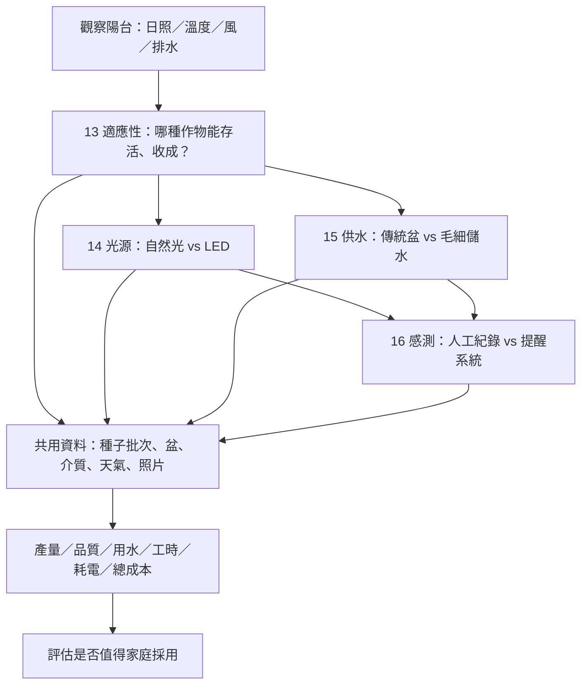

### 8.2 場地踏勘表（先填，不能猜）

| 場地資料 | 需記錄內容 | 目前數值 |
|---|---|---|
| 實際種植地點 | 家庭／學校／其他；使用同意 | 待確認 |
| 陽台或平台可用面積 | 平方公尺（m²） | 待測 |
| 朝向 | 正北偏角／羅盤方向 | 待測 |
| 直射日照 | 每日幾小時；分季節 | 待測 |
| 遮蔭與反射 | 建物遮蔭、牆面反射 | 待測 |
| 風與高溫 | 最高／最低溫、風險事件 | 待測 |
| 排水與承重 | 住家規定、結構承重、安全線 | 需確認 |
| 電力與防水 | 室內插座、供電距離、用電防護 | 需確認 |
| 維護人力 | 每週可投入分鐘數 | 待確認 |
| 可用預算 | 初期設備上限NT$ | 待確認 |

### 8.3 作物選擇的研究樹

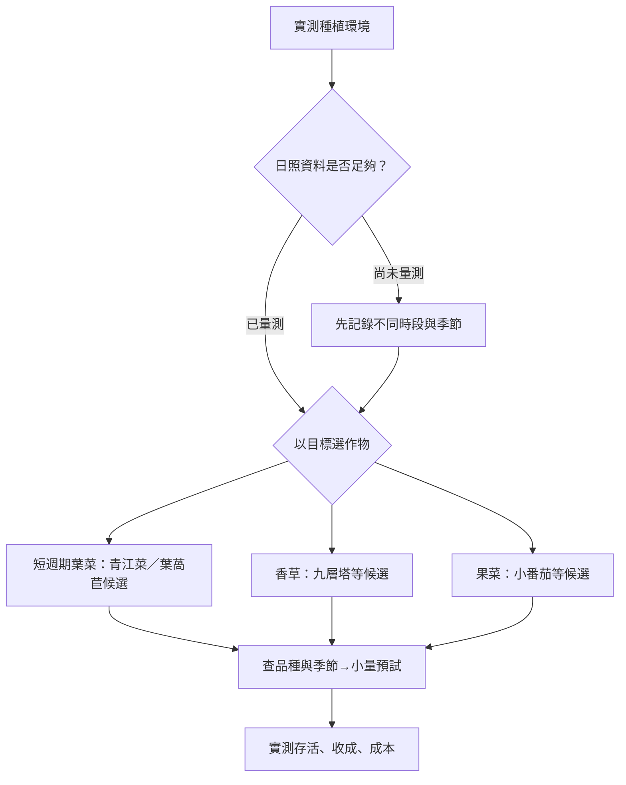

此圖為 **提出問題的工具**，不是栽培適性保證。不同季節、品種與熱環境會改變結果。小番茄等結果作物往往需要較充足光照與栽培時間；探索時可先用短期葉菜降低變因，再考慮果菜。

### 8.4 A/B/C光照實驗模板

| 面向 | A 自然光 | B LED | C 自然光＋補光（可選） |
|---|---|---|---|
| 品種與種子批次 | 同一批 | 同一批 | 同一批 |
| 盆器／介質 | 盡量相同 | 盡量相同 | 盡量相同 |
| 照明 | 實測自然光 | 紀錄燈具與距離 | 自然光與補光分別記錄 |
| PPFD | 待測 | 待測 | 待測 |
| DLI | 待計 | 待計 | 待計 |
| 日平均溫度 | 待測 | 待測 | 待測 |
| 日均相對濕度 | 待測 | 待測 | 待測 |
| 植株數與存活 | 待填 | 待填 | 待填 |
| 可食鮮重g | 待測 | 待測 | 待測 |
| 乾重g／含水率 | 可選 | 可選 | 可選 |
| Brix等化學測試 | 僅有適用設備與安全指導時 | 同左 | 同左 |
| 總耗電kWh | 待測 | 待測 | 待測 |
| 單位鮮重成本 | 待算 | 待算 | 待算 |

**DLI計算：** DLI（mol/m²/day）= PPFD（μmol/m²/s）× 有效照光秒數 ÷ 1,000,000。  
例如PPFD為200、持續16小時，算術上DLI = **11.52 mol/m²/day**。這只是公式示例，**並非對此種植物的建議光量或實測結果**。若自然光隨時段變動，應分時間區間累加PPFD，不可用單點瞬時值冒充全天累積光量。

**植物成分的界線：** 葉片顏色不能直接代表葉綠素定量，Brix不能直接代表總糖或營養價值，未經校正的手機光感應器不等同專業PPFD感測器。成分測試需用符合測量目的的方法，最好有學校實驗室與老師指導。

### 8.5 A/B供水實驗模板

| 量測 | 傳統盆A | 毛細儲水盆B | 注意 |
|---|---:|---:|---|
| 初期製作成本NT$ | 待填 | 待填 | 器材分攤獨立列出 |
| 研究天數d | 待填 | 待填 | 需相同期間 |
| 自來水補水L | 待填 | 待填 | 雨水需另記 |
| 累計雨水補充L | 待填 | 待填 | 無法量到要說明 |
| 維護分鐘min | 待填 | 待填 | 不只算澆水 |
| 可食鮮重g | 待填 | 待填 | 相同成熟判定 |
| 用水生產力g/L | 待算 | 待算 | 分母與水來源要清楚 |
| 產量每維護分鐘g/min | 待算 | 待算 | 不能分母為0 |
| 單位產量成本NT$/kg | 待算 | 待算 | 無收成時標示不可計算 |

**限制：** 若兩組盆器材質、容積和儲水量都不同，所得是「供水系統整體比較」，不能獨立歸因於毛細現象。DIYGreen官網和FAQ的低維護宣稱可作為研究背景，但本研究必須另行取得自己量到的補水紀錄。來源見第15章。

### 8.6 AI智慧農園的技術成熟度分層

| 階段 | 做什麼 | 不做什麼 | 可以驗證什麼 |
|---|---|---|---|
| 0 人工日誌 | 手寫表／試算表 | 不先買一堆感測器 | 問題是否真的存在 |
| 1 資料自動收集 | 溫濕度、光照、介質水分 | 不把未校正讀值當真值 | 數據缺失與誤差 |
| 2 規則提醒 | 依明確條件通知 | 不稱規則判斷是AI模型 | 誤報、漏報、工時 |
| 3 AI建議（可選） | 足夠資料後試模型 | 不保證一定更好 | 與規則基準的差異 |
| 4 成本驗證 | 比較設備、工時、產量 | 不忽略折舊與耗電 | 家庭是否值得採用 |

### 8.7 共同物料清單（數量與價格留空）

| 物料／設備 | 用途 | 必要性 | 數量 | 單價NT$ | 小計NT$ | 購買／借用 |
|---|---|---|---:|---:|---:|---|
| 種子／種苗 | 同批次生長比較 | 基本 | 待填 | 待填 | 待填 | 待填 |
| 同型盆器與承盤 | 降低尺寸差異 | 基本 | 待填 | 待填 | 待填 | 待填 |
| 培養介質／肥料 | 一致栽培 | 基本 | 待填 | 待填 | 待填 | 待填 |
| 電子秤與量尺 | 重量、株高 | 基本 | 待填 | 待填 | 待填 | 待填 |
| 量杯／水表 | 用水 | 15 必要 | 待填 | 待填 | 待填 | 待填 |
| 溫濕度計 | 環境 | 建議 | 待填 | 待填 | 待填 | 待填 |
| PPFD適用設備 | 光量 | 14必要／可借 | 待填 | 待填 | 待填 | 待填 |
| LED植物燈與電錶 | 光／電 | 14必要 | 待填 | 待填 | 待填 | 待填 |
| 毛細引水條／儲水件 | 毛細供水 | 15必要 | 待填 | 待填 | 待填 | 待填 |
| 感測器與記錄設備 | 16智慧化 | 選擇性 | 待填 | 待填 | 待填 | 待填 |

---

## 9. 教師檢查與階段驗收

### 9.1 教師審查流程

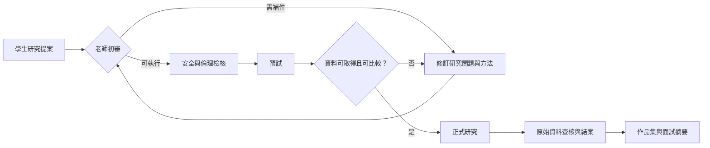

### 9.2 提案審查清單（可逐項勾選）

- [ ] 題目是學生自己能解釋的生活問題，而不是只追逐工具。
- [ ] 有明確研究問題、可被推翻的假設與專業文獻來源。
- [ ] 自變因、依變因、控制變因與干擾因子有寫清楚。
- [ ] 樣本／受訪者與抽樣方式不會直接導致過度推論。
- [ ] 有適合年齡與場域的安全、倫理、隱私措施。
- [ ] 時間、設備、實驗空間、老師協助與成本可行。
- [ ] 有事先定義的主要指標與退出條件。
- [ ] 有原始資料記錄、誤差處理與封存方式。
- [ ] 有一份即使結果不如預期仍能完成的結案方案。
- [ ] 不宣稱未取得的實驗數據，也不假造受訪者。

### 9.3 建議老師評量規準（非學校官方評分標準）

| 評量項 | 權重（建議） | 優良證據 | 說明／得分 |
|---|---:|---|---|
| 研究問題與動機 | 15% | 動機具體、研究問題清楚 | 待填 |
| 文獻與資料來源 | 15% | 能識別一手／二手來源與限制 | 待填 |
| 方法與對照品質 | 20% | 變因明確、紀錄可重複 | 待填 |
| 資料品質與分析 | 20% | 原始檔可查核、圖表有單位 | 待填 |
| 主動修正與反思 | 20% | 說明失敗、決策與替代方案 | 待填 |
| 表達與學習倫理 | 10% | 溝通清楚、尊重他人與來源 | 待填 |
| **合計** | **100%** | 不以結果好壞單獨決定分數 | **待填** |

### 9.4 與老師的三次關鍵會議

1. **提案前：** 允許執行的題目、資源、時數、倫理與安全底線。
2. **預試後：** 量測是否可行，是否需要調整樣本、流程或研究問題。
3. **正式結案前：** 數據一致性、推論限制、學習歷程真實性與公開內容。

---

## 10. 通用資料表與結案報告模板

> 本章可以直接複製到某個正式選定的專題當作報告骨架。所有方括號是待填欄位，不得當作已發生的事實。

### 10.1 一頁研究提案表

| 欄位 | 待填內容 |
|---|---|
| 題目／版本／日期 | [題目]／[vX.X]／[YYYY-MM-DD] |
| 我為什麼選這題 | [與生活相關的具體困擾] |
| 研究問題（1句） | [研究問題] |
| 學生自己提出的假設 | [可被推翻的預測] |
| 最重要的成果指標 | [指標、單位、測量時點] |
| 研究範圍／排除範圍 | [研究什麼／不研究什麼] |
| 自變因／依變因 | [A]／[B] |
| 控制條件與干擾因子 | [清單] |
| 樣本數與取樣方法 | [數量／來源／理由] |
| 實驗或調查步驟 | [1–5步] |
| 預計週數／實際可用時數 | [W週]／[時數] |
| 預算上限／實際支出 | [NT$]／[NT$] |
| 風險、倫理與老師支持 | [檢查項目] |
| 預期交付作品 | [圖表／程式／實物／報告] |
| 老師核可／日期 | [待填] |

### 10.2 統一的每週研究日誌

| 日期 | 週次 | 做了什麼 | 原始證據連結 | 異常／失敗 | 下一步 | 花費NT$ | 工時min |
|---|---|---|---|---|---|---:|---:|
| [日期] | W[ ] | [內容] | [資料路徑] | [如實記錄] | [下一步] | [ ] | [ ] |
| [日期] | W[ ] | [內容] | [資料路徑] | [如實記錄] | [下一步] | [ ] | [ ] |
| [日期] | W[ ] | [內容] | [資料路徑] | [如實記錄] | [下一步] | [ ] | [ ] |

### 10.3 CSV資料字典：照片、試驗與問卷都能對應

| 欄位名 | 說明 | 型別 | 單位／例子 |
|---|---|---|---|
| record_id | 唯一紀錄號 | string | T14-A-001 |
| sample_id | 不可識別真人的樣本號 | string | A-01 |
| timestamp | 觀察時間，含時區 | ISO 8601 | 2026-11-12T10:00:00+08:00（格式示例） |
| treatment | 實驗組別 | string | A、B、C |
| variable | 測量變數 | string | fresh_weight_g |
| value | 原始測值；缺值保持空白／NA | number/null | 待測 |
| unit | 單位 | string | g、L、kWh、NT$、min |
| method | 量測方法與工具 | string | 電子秤／量杯 |
| operator | 研究者編號 | string | S01 |
| quality_flag | 正常／缺值／異常／排除 | string | valid / missing / excluded |
| source_path | 原始照片或檔案路徑 | string | [待填] |
| note | 實驗例外與解釋 | string | [待填] |

**注意：** 上面的日期和樣本編號只是「格式示例」，並非真實紀錄。所有資料匯出時保留原始檔，分析資料另存新版本，不覆蓋原始數據。

### 10.4 正式結案報告：可直接填字與數字

#### 封面

- 專題名稱：[ ]
- 學期、學校、年級：[ ]
- 研究期間：[開始日期]—[結束日期]
- 學生：[ ]；指導老師：[ ]（如適用）
- 報告版本與提交日：[ ]
- 資料與程式版本：[Git commit／附件號]

#### 摘要（建議300–500字）

**背景：** [生活上看到的問題]。**目的：** [想比較什麼]。**方法：** [對照、樣本數、時間、量測法]。**結果：** [主要數值、單位、差異與不確定性]。**結論：** [證據支持哪一部分、不能推出什麼]。**反思：** [遇到的困難與修正]。

#### 第一章：研究動機與問題

- 生活問題：[ ]
- 現有方案的限制：[ ]
- 為什麼值得研究：[ ]
- 主要問題：[ ]；次要問題：[ ]
- 研究假設與反假設：[ ]

#### 第二章：文獻、資料與背景

| 來源／年份 | 核心資訊 | 來源性質 | 與本研究關係 | 限制／待查 |
|---|---|---|---|---|
| [連結] | [ ] | 官方／學術／訪談／其他 | [ ] | [ ] |
| [連結] | [ ] | [ ] | [ ] | [ ] |

#### 第三章：方法

- 研究設計：[ ]
- 樣本數與取樣：[ ]
- 自變因：[ ]；依變因：[ ]；控制變因：[ ]
- 設備、精度、校正：[ ]
- 分組與隨機化（如適用）：[ ]
- 觀察起迄與次數：[ ]
- 異常與排除規則：[ ]
- 安全、倫理、資料授權：[ ]

#### 第四章：結果（只填實測）

| 指標 | A組 | B組 | C組（可選） | 差異及單位 | 附圖／證據 |
|---|---:|---:|---:|---|---|
| 樣本數n | [ ] | [ ] | [ ] | — | [ ] |
| 研究期間d | [ ] | [ ] | [ ] | — | [ ] |
| 主要指標1 | [ ] | [ ] | [ ] | [ ] | 圖1 |
| 主要指標2 | [ ] | [ ] | [ ] | [ ] | 圖2 |
| 樣本變異／不確定性 | [ ] | [ ] | [ ] | [ ] | 圖3 |
| 總成本NT$ | [ ] | [ ] | [ ] | [ ] | 圖4 |
| 維護工時min | [ ] | [ ] | [ ] | [ ] | 圖5 |

#### 第五章：討論與反例

- 原假設：[支持／部分支持／不支持／無法判斷]
- 哪些觀測資料直接支持結論：[ ]
- 有沒有相反資料或意外：[ ]
- 可能的干擾因子：[ ]
- 樣本數與外推限制：[ ]
- 不能從本次研究得出的結論：[ ]
- 與文獻不同的原因可能是：[ ]（注明推測）

#### 第六章：成本、時間與實用性

| 成本類型 | A組NT$ | B組NT$ | 備註 |
|---|---:|---:|---|
| 初期設備分攤 | [ ] | [ ] | 使用壽命／分攤假設：[ ] |
| 耗材 | [ ] | [ ] | [ ] |
| 水電 | [ ] | [ ] | [ ] |
| 損耗 | [ ] | [ ] | [ ] |
| 現金支出合計 | [ ] | [ ] | [ ] |
| 維護工時min | [ ] | [ ] | 與現金成本分開 |
| 若將工時換算成本 | [ ] | [ ] | 時薪假設：[ ] |
| 單位成果成本 | [ ] | [ ] | 功能單位：[ ] |

#### 第七章：結論與反思

- **最重要的三個發現：** [ ]、[ ]、[ ]。
- **最意外的失敗：** [ ]；我如何處理：[ ]。
- **如果重做一次：** [ ]。
- **下一步想問的問題：** [ ]。
- **我自己完成的工作與他人協助：** [區分]。
- **附件：** 原始資料、問卷版本、程式碼、設備校正、照片、教師回饋。

### 10.5 結案成果矩陣（可比對預期 vs 實際）

| 面向 | 原本預期 | 實際完成 | 證據連結 | 未完成的原因 |
|---|---|---|---|---|
| 研究設計 | [ ] | [ ] | [ ] | [ ] |
| 數據收集 | [ ] | [ ] | [ ] | [ ] |
| 實作原型 | [ ] | [ ] | [ ] | [ ] |
| 使用者回饋 | [ ] | [ ] | [ ] | [ ] |
| 統計／成本分析 | [ ] | [ ] | [ ] | [ ] |
| 公開展示 | [ ] | [ ] | [ ] | [ ] |
| 個人反思 | [ ] | [ ] | [ ] | [ ] |

---

## 11. 預期結案圖表與 Mermaid 填值模板

### 11.1 最少應有的「成果圖表六件組」

| 圖號 | 圖表名稱 | X軸／Y軸或欄位 | 欲回答的問題 | 必須提供的原始資料 |
|---|---|---|---|---|
| 圖1 | 問題與研究架構流程 | 問題→假設→方法→結果 | 研究邏輯是否完整 | 研究提案版本 |
| 圖2 | 樣本、分組與週次 | 組別×週次 | 哪些資料可比較 | 樣本清單與日誌 |
| 圖3 | 最重要的結果比較 | 分組×主要量化指標 | 假設是否被支持 | 每筆原始量測 |
| 圖4 | 趨勢／變化 | 時間×觀測值 | 效果隨時間怎麼變 | 連續觀察記錄 |
| 圖5 | 資源與成本 | 組別×水電、材料、工時 | 效益的代價是什麼 | 發票／電錶／工時 |
| 圖6 | 不確定性與限制 | 失敗／缺值／敏感度 | 結論可信到哪裡 | 排除紀錄、反例 |

其他題目可再加入混淆矩陣、文化地圖、感測校正、損益兩平、材料耐折或碳排敏感度分析。

### 11.2 圖1：研究結案邏輯（不需數字）

### 11.3 圖2：陽台農園組別與主要指標（直接填表）

| 指標／單位 | A組測量值 | B組測量值 | C組測量值 | 圖型 |
|---|---:|---:|---:|---|
| 可食鮮重g | [填數字] | [填數字] | [填數字] | 長條圖＋每盆點 |
| 乾重g | [填數字] | [填數字] | [填數字] | 長條圖 |
| 存活率% | [填數字] | [填數字] | [填數字] | 長條圖 |
| 累計補水L | [填數字] | [填數字] | [填數字] | 累積折線圖 |
| 總用電kWh | [填數字] | [填數字] | [填數字] | 長條圖 |
| 維護min | [填數字] | [填數字] | [填數字] | 長條圖 |
| 單位收成成本NT$/100g | [填數字] | [填數字] | [填數字] | 長條圖 |

### 11.4 圖3：可食鮮重長條圖（Mermaid 可直接替換數字）

**注意：下圖所有的0只是空模板的佔位值，不代表實測為0。** 將 bar 的0改為每組的實際平均鮮重，必要時調整Y軸上限；如果某組沒有可食收成，請在文字明確註記。

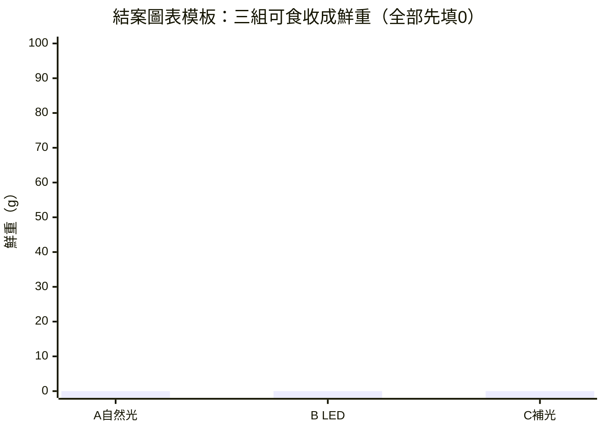

此Mermaid圖使用 xychart-beta，能否顯示需視GitHub／其他Markdown播放器版本而定；若NotebookLM不讀圖，請一併提供圖下敘述與上方表格。

### 11.5 圖4：兩種供水系統的補水量模板

**注意：下圖所有的0只是佔位值。** 應在每組樣本與時間範圍一致的情況下填入補水量。

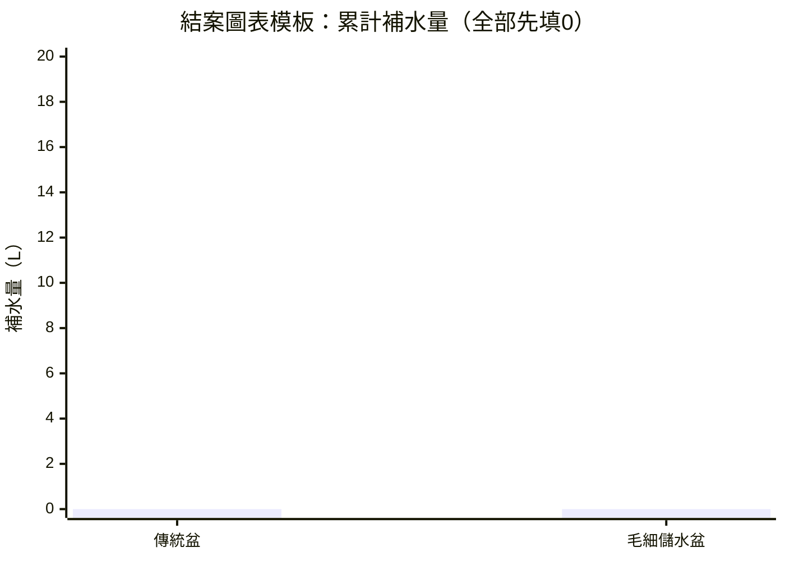

### 11.6 圖5：成本、收成與效率的必要公式

- **鮮重含水率（%）** = (鮮重－乾重)／鮮重 × 100。鮮重需大於0。
- **可食產量密度（g/m²）** = 可食鮮重g／實際種植面積m²。
- **用水生產力（g/L）** = 可食鮮重g／明確定義的用水L；要分清補水量與真實蒸散。
- **維護生產力（g/min）** = 可食鮮重g／維護分鐘數。
- **成本每100g（NT$/100g）** = 總成本NT$／可食鮮重g × 100。
- **每單位節電或節水%** = (基準值－實驗值)／基準值 × 100；基準值若為0不得計算。
- **召回率（%）** = 真陽性／（真陽性＋假陰性）×100；用於分類／提醒類研究。
- **簡化毛利（NT$）** = 實際營收－可歸屬變動成本。不能當成純利。
- **損益兩平件數** = 固定成本／（單價－單位變動成本）；分母需大於0。

### 11.7 圖6：研究限制的「證據鏈」

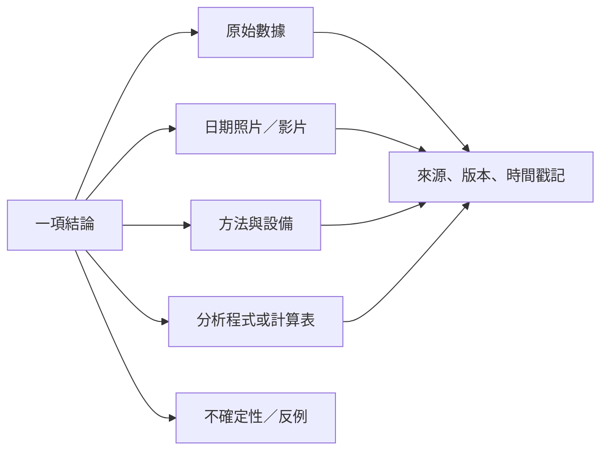

### 11.8 不可做的圖表錯誤

1. 只畫平均，不展示樣本數、變異或異常值。
2. 不同樣本或不同期間，卻直接比較絕對數量。
3. 把預估、模擬和實測畫在同一圖卻未標示。
4. 省略座標軸單位、資料來源、日期或版本。
5. 為了呈現效果挑選有利的時間點或刪除失敗樣本。
6. 從少數盆栽或少量受訪者推論全臺灣家庭。

---

## 12. 學習歷程、作品集與入學面試

### 12.1 教授想檢查的不是圖表有多漂亮，而是證據如何形成

此處是 **整理作品時的建議呈現角度**，不代表任何大學或科系公告的審查公式。

| 展示材料 | 回答的問題 | 必附證據 |
|---|---|---|
| 研究動機1頁 | 為何是你的問題？ | 生活觀察、早期筆記 |
| 問題收斂地圖 | 為何沒有做所有題目？ | 選題矩陣與淘汰理由 |
| 原理與方法1–2頁 | 你真的懂研究設計嗎？ | 對照流程、材料、變因 |
| 主要數據圖2–3張 | 有什麼發現？ | 原始數據、單位、版本 |
| 失敗與修正1頁 | 遇到意外如何決策？ | 改版紀錄、老師回饋 |
| 跨學科連結1頁 | 理論如何接上生活？ | 專業概念與實際限制 |
| 延伸1頁 | 下一步想研究什麼？ | 新問題與可行性評估 |

### 12.2 可直接練習的面試問題

1. 為何從家庭素食生活出發？哪個事件讓你想研究？
2. 16題中你為什麼挑這兩題，而不是技術最炫的那題？
3. 你怎麼定義主要成果指標？為何不是其他指標？
4. 你的實驗有哪些干擾因素？你怎麼控制？
5. 如果數據和原假設相反，你會如何寫結論？
6. 你有沒有做失敗的方案？那次失敗教會你什麼？
7. 這份研究與生物／化學／資訊／經濟學的哪個原理有關？
8. 哪些成果是你獨立完成？老師、AI或家人提供了哪些協助？
9. 如果重新執行，有哪些方法或樣本要增加？
10. 這個作品如何對真實家庭、學校或社會有價值？

### 12.3 作品集摘要模板（只填真實完成項目）

**我發現的問題：** [ ]  
**為什麼重要：** [ ]  
**我親自做的主要決策：** [ ]  
**研究方法及理由：** [ ]  
**最重要的三個數據：** [含單位、n、來源]  
**失敗與轉折：** [ ]  
**老師／家人／AI協助範圍：** [ ]  
**我學到的知識與技能：** [ ]  
**研究限制：** [ ]  
**未來想學的課程或領域：** [ ]  

**注意：** 入學申請時必須遵循當年度該校系公告的資料項目、格式、字數和截止時間，不能直接以本模板當作官方要求。

---

## 13. NotebookLM 廣播轉換用文字

> 本章是為語音模型準備的 **純文字口述稿與提問**。即使工具未讀取Mermaid圖，也可以理解；可作為NotebookLM的來源之一。**本文件本身並沒有產生音訊。**

### 13.1 建議的音訊主題名稱

**「從每天吃什麼，到自己設計實驗：一份高中自主學習研究地圖」**

### 13.2 可直接朗讀的導讀稿

這份計畫從一個很普通的家庭問題開始：每天吃什麼？如果家裡吃素，我們怎麼知道營養是否足夠，哪些包裝食品真的符合飲食需要，校園是否能方便地選擇素食，素食是不是比較便宜？

當我們繼續問下去，研究就不只和食物有關。它會延伸到生物、化學、資料科學、經濟、環境、歷史、文化和服務設計。例如，能不能用人工智慧協助辨識食品成分？能不能用實驗比較植物性材料的強度？能不能把家庭剩菜、碳排和採買成本，用可以查核的數字呈現？這些問題讓我們整理出前十二個候選研究題目。

接著又出現了另一個具體的生活場景：家庭陽台能不能自己種蔬菜？如果陽光不足，用植物燈是否划算？如果採用毛細供水，是否更省水、更省時間？如果裝上感測器，能否讓管理簡單一些，還是只是增加設備費用？這些追問形成第十三到第十六題。它們受到DIYGreen都市農園設計的啟發，但我們不能直接把別人的展示結果當成自己的結論。

整份計畫打算用三個學期，從生活問題、實驗驗證到社會應用逐步探索。原本每學期保留四個候選題目，最後選兩題完成，三學期共形成六個正式專題。不過目前還沒有選定是哪六題；後來新增的陽台農園四題，也尚未排入特定學期。

我們強調的不是一定要證明素食最好、LED最有效，或人工智慧一定能改善生活。真正重要的是提出可被推翻的假設，設計能比較的條件，留下原始數據、照片、成本、失敗記錄，再誠實寫出證據支持了什麼、沒有支持什麼。

對學生來說，這份計畫能清楚列出每週可做的事和每一步要留下的資料。對老師來說，它提供研究問題、變因、倫理、時間、評量與結案檢核。未來整理學習歷程或申請入學時，這些材料也能回答最重要的問題：學生自己做了哪些決策？遇到問題時如何思考？最後有什麼真正的成長？

因此，Plant-Based Living Lab不是一份先決定標準答案的企劃。它是一張從生活走向研究的地圖。真正的成果，要等學生把資料量出來，才會慢慢長出形狀。

### 13.3 給NotebookLM的內容組織建議

- **第1集：** 起點、心智圖、題目01–04、如何從生活問題變成研究。
- **第2集：** 題目05–12、實驗、文化、社會、AI與成本。
- **第3集：** 題目13–16、家庭陽台、LED、毛細供水與智慧化。
- **第4集：** 三學期策略、老師如何評估、結案表與入學申請。

這只是建議分集，不代表已要求或已生成四集音檔。

### 13.4 語音導讀時要特別避免

- 不要唸出「學生已完成」等未發生的事。
- 圖表空白代表待測，不是結果為0。
- AI是研究工具或受測方案，不能代替作者提出真實實驗經驗。
- 若語音摘要引用外部網站，應可回溯到第15章來源。

---

## 14. 研究倫理、風險與資料管理

### 14.1 食品與人體安全

- 營養分析是教育用途的估算，不是個別醫療診斷或治療建議。
- 乳液僅限非人體用途的基礎乳化觀察；未做完整化粧品安全測試不得使用、贈送或販售。
- 保鮮實驗中的異常或腐敗食品不能因為外觀尚可就食用。
- 食品標示辨識App不得保證可排除過敏原、動物來源或生產交叉接觸。

### 14.2 陽台種植與電氣安全

- 先取得場地管理者／家長同意，確認承重、排水、掉落風險、風災與建築規範。
- LED、延長線、感測器與電源供應器必須符合用電安全，遠離積水並設適當防護。
- 颱風期間停止外部操作，必要時提前收納，不靠「盆器很重」就假設足以抗風。
- 注意西曬高溫的可能性，但實際是否有西曬須在本次場地確認，不直接套用其他情境。

### 14.3 問卷、採訪與商家資料

- 調查前需取得校方、受訪者／監護人（如適用）同意；避免蒐集健康、宗教等非必要敏感資料。
- 對外報告提供匿名統計，不公開電話、住址、個別作答或可辨識照片。
- 商家標示與營業資訊以有來源的查核結果為準，註明日期，不捏造即時資訊。

### 14.4 AI使用的透明度

| AI使用項目 | 可接受的做法 | 應避免 |
|---|---|---|
| 文獻探索 | 提供關鍵字，逐一回原文查證 | 把AI杜撰來源當論文 |
| 程式原型 | 註明工具及人工驗收 | 宣稱未自行確認的程式能力 |
| 圖文排版 | 適當協助可視化 | 用生成圖片充當真實實驗照片 |
| 數據分析 | 留下程式、公式及版本 | 為了好看調整或創造原始資料 |
| 反思與面試 | 協助整理真實經驗 | 虛構學生親身經歷 |

### 14.5 資料封存的最低要求

每個專題至少封存：研究提案v1、變更記錄、原始資料、資料字典、分析檔、成果圖表、結案報告、來源清單及反思。公開版要先去識別化；若資料無法合法公開，可放分析流程與匿名示例，並說明原件保存位置。

---

## 15. 可查證的參考資源與待補事項

### 15.1 已確認可作背景閱讀的來源

1. **DIYGreen 官方網站** — https://diygreen.tw/ 。介紹回收瓶、循環型都市農園與毛細供水設計。網站宣稱是研究假設或背景，不是本專題的實測證據。
2. **DIYGreen 常見問答** — https://diygreen.tw/常見問與答集faqs/ 。可查詢儲水、澆水頻率、盆器面積、荷重等官方說明；具體採用前仍須以現場條件與安全查核為準。
3. **陽明交通大學115-1微學分課程：DIYGreen蔬果花卉低維護種植法實作** — https://ict.nycu.edu.tw/course/【115-1微學分課程】diygreen-蔬果花卉低維護種植法實作-diygreen-low/ 。公開課程說明列出高正忠教授、DIYGreen套件原理、盆型／爬藤／框型實作與觀察記錄。
4. **衛生福利部／食品營養相關官方資源入口** — https://www.mohw.gov.tw/ 。選擇適用營養資料時須核對資料集版本、營養素與單位。
5. **臺灣政府資料開放平台** — https://data.gov.tw/ 。可搜尋與主題相關的開放資料；實際資料集尚未指定。
6. **植物照明研究與DLI教學** — 先查核大學農業推廣文獻及PPFD/DLI量測標準，再決定適用植物和範圍；不同物種、苗齡與栽培情境不能混用。

### 15.2 待補的查證工作（不是既有事實）

- [ ] 學生實際學校的自主學習學分、每週時數、報告格式與倫理規範。
- [ ] 學生自己的學習興趣、可用設備、指導老師與可支配時間。
- [ ] 家庭或校方是否提供可使用的陽台／實驗空間。
- [ ] 研究對象、問卷同意與必要的校內行政程序。
- [ ] AI標示辨識的食品分類標準、公開資料授權與評測標準。
- [ ] 植物材料、乳液研究可用的安全實驗器材及教師指導。
- [ ] 光學感測器是否能可靠量PPFD，是否可借用設備。
- [ ] 實際食材價格、碳排係數、電費單價與設備壽命。
- [ ] 高中入學後每學期的真實日曆與考試時間。
- [ ] 目標大學與學系當年度正式申請資料要求。

---

## 16. 結案封存與下一版決策

### 16.1 完成一題的定義

一題正式結案，不代表一定得到正向成果。至少要有：

- [ ] 問題、假設、方法、倫理與安全記錄。
- [ ] 真正執行過的過程與原始證據。
- [ ] 可核對單位、樣本與時間的成果表。
- [ ] 至少一張主要結果圖和一張成本／資源分析圖（若適用）。
- [ ] 對干擾、失敗、偏差與限制的誠實討論。
- [ ] 學生個人決策與學習反思。
- [ ] 老師檢視與修改紀錄（若有老師指導）。
- [ ] 公開或私有封存位置及權限說明。

### 16.2 最終決策留白：不提前替學生選題

| 學期 | 原候選 | 已選正式題目A | 已選正式題目B | 是否納入13–16 | 決定日期 |
|---|---|---|---|---|---|
| 第一學期 | 01–04 | 尚未決定 | 尚未決定 | 尚未決定 | 待填 |
| 第二學期 | 05–08 | 尚未決定 | 尚未決定 | 尚未決定 | 待填 |
| 第三學期 | 09–12 | 尚未決定 | 尚未決定 | 尚未決定 | 待填 |

### 16.3 這份文件的完成標準

本版完成的是：**把先前討論的研究地圖、全部16個候選題目、三學期策略、老師審查、NotebookLM口語稿、學習歷程與數字填入型結案模板整合成一份可使用的主文件**。不包含未經同意的最終選題，不包含真實學生數據，也不代表任何學校或大學已核准。

下一步應由學生與老師用第5章矩陣做候選題收斂，再將真正選中的題目複製成獨立實驗計畫。所有結果以真實執行後資料為準。

---

**版本紀錄**

| 版本 | 日期 | 主要更新 |
|---|---|---|
| 1.0 | 2026-11-12 | 整合16題、心智圖、網站地圖、三學期規劃、Mermaid、教師審查、結案填值模板、NotebookLM導讀。 |
